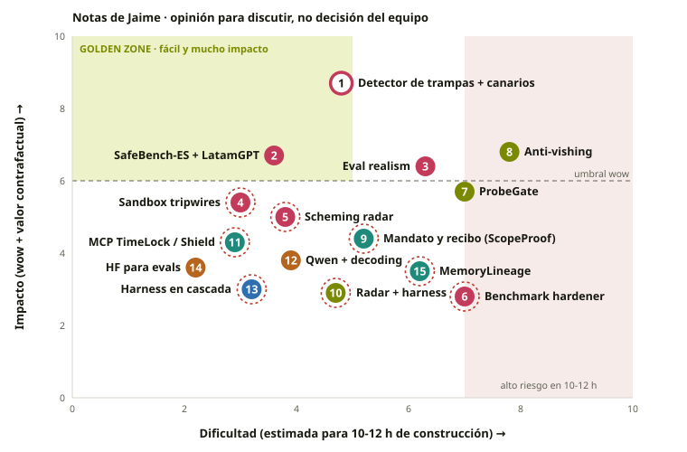

# Platanus Hack 26 — AI Security

> **Estado:** etapa de research. Todavía no hay idea definida; estamos leyendo y juntando notas en `research/`.

## Notas de Jaime: mapa de ideas (dificultad vs impacto)

> Opinión personal de Jaime para discutir, **no una decisión del equipo**. La idea la elegimos entre todos.



Versión 2, actualizada con el brief de Juanfe (`docs/ai-safety-track-brief.md`). El anillo rojo punteado marca el carril saturado según el brief. Razones de cada punto en [research/notas/jaime-aza/mapa-ideas-equipo.md](research/notas/jaime-aza/mapa-ideas-equipo.md).

## Estructura

| Carpeta | Para qué |
|---|---|
| `research/papers/` | Papers, posts y referencias (PDFs o links) |
| `research/notas/` | Resúmenes, ideas candidatas y preguntas abiertas |
| `src/ph26/ataques/` | Red team: generadores de prompts adversarios, inyecciones, jailbreaks |
| `src/ph26/defensas/` | Blue team: guardrails, filtros, detectores, sandboxing |
| `src/ph26/evals/` | Harness de evaluación: corre ataques contra defensas y mide |
| `datos/crudos/`, `datos/procesados/` | Datasets (no se versionan) |
| `experimentos/` | Una carpeta por corrida, con config y resultados |
| `notebooks/` | Exploración |
| `demo/` | Lo que se muestra al jurado (app/CLI/video) |
| `docs/` | Modelo de amenazas, arquitectura, pitch |
| `entrega/` | Material final para subir |
| `scripts/` | Utilidades sueltas |
| `tests/` | Tests |

## Uso

```bash
cp .env.example .env   # completar claves
make setup
make test
```

## Reglas de la casa

- Los ataques se prueban **solo** contra sistemas propios o con autorización explícita.
- Nada de claves en el repo: van en `.env`.
