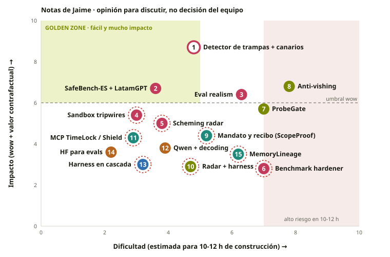

# Notas de Jaime: mapa de ideas (dificultad vs impacto)

> **Esto es una opinión personal de Jaime, no una decisión del equipo.** Todo lo que hay en `research/notas/jaime-aza/` son mis notas para discutir; la elección de la idea la tomamos juntos.

Versión 3 (21-11-2026). Parte del brief de Juanfe (`docs/ai-safety-track-brief.md`) y de una segunda investigación que verificó sus cifras, buscó qué existe ya y leyó los repos de los equipos del tour. Detalle y puntuación con la rúbrica en [investigacion-2-brief-y-rubrica.md](investigacion-2-brief-y-rubrica.md).

**Cómo leerlo.** Colores por origen: rosado, brief de Juanfe; verde oliva, Jaime; azul, Mauricio; verde azulado, Tomás; naranjo, reunión con el mentor sin autor en el repo. El círculo con borde rosado une una idea del brief con mi investigación. **Anillo rojo punteado: ya existe o el jurado ya lo vio** (brief e investigación). Golden zone: dificultad menor a 5 e impacto mayor a 6. Zona rosada: alto riesgo en el tiempo que hay.

| # | Idea | Origen | Dificultad | Impacto | Por qué está ahí |
|---|---|---|---|---|---|
| 1 | Detector de trampas + canarios | Brief + Jaime | 4,8 | 8,7 | A1 del brief con el canal de señuelos de A5. Nadie en el tour hizo detección de trampas ni evals. Existen piezas sueltas (reglas sobre diffs, jueces LLM), pero no una herramienta con precisión y recall medidos. Núcleo técnico: restaurar los tests originales y correrlos con entradas perturbadas. Hay datos etiquetados (ImpossibleBench, Terminal Wrench). |
| 2 | SafeBench-ES + LatamGPT | Brief de Juanfe | 3,6 | 6,7 | B3 + D3. Baja tras investigar: con peticiones directas los modelos frontera rechazan casi igual en español que en inglés, y el 79 % del brief no es de español. Se sostiene como primer report card de seguridad de LatamGPT (se puede correr por API en Featherless) y recall de guards en chileno. Riesgo: resultado nulo. |
| 3 | Eval realism | Brief de Juanfe | 6,3 | 6,4 | A4. Nuevo para el jurado, pero la métrica es frágil según la literatura y la demo es difícil de volver visible. |
| 4 | Sandbox tripwires | Brief de Juanfe | 3,0 | 5,4 | A5. Ya hay varios proyectos chicos (canaryhook, honeypot-control de un hackathon de nov-2026) y Owliver y Agent Zero usaron canarios en el tour. Mejor como componente del detector. |
| 5 | Scheming radar | Brief de Juanfe | 3,8 | 5,0 | A3. El propio CLTR ya opera un observatorio con más de 1.600 incidentes, y hay al menos cinco rastreadores más. Solo quedaría sumar GitHub y español. Demo sin villano en vivo. |
| 6 | Benchmark hardener | Brief de Juanfe | 7,0 | 2,8 | A2. El paper citado en el brief ya lo implementó con código abierto (harden-v0) y Terminal Bench lo adoptó. |
| 7 | ProbeGate | Jaime | 7,0 | 5,7 | Monitor con sondas sobre activaciones. Necesita pesos abiertos y GPU; difícil de explicar en 2 minutos. |
| 8 | Anti-vishing | Jaime | 7,8 | 6,8 | B1. Wow alto, pero entrenar audio es arriesgado y SafeLine (Hack 25) ya hizo un detector de llamadas de estafa. |
| 9 | Mandato y recibo (ScopeProof) | Tomás | 5,2 | 4,4 | C2. Lo más repetido: AP2, Visa TAP, cuatro borradores IETF de recibos firmados, y en el tour Specter, Roxy y HAWK. |
| 10 | Radar + harness | Jaime | 4,7 | 2,9 | Mi principal anterior. Agent Zero (Caracas) ya hizo el ciclo ataque, confirmación y regla, con 1.176 pruebas; y un scraper de jailbreaks roza la línea roja del brief. |
| 11 | MCP TimeLock / Shield | Tomás | 2,9 | 4,3 | Roxy e Ikarus ya son gateways MCP. Solo quedaría el nicho de escáner de plug-ins. |
| 12 | Qwen + decoding | Reunión con el mentor | 3,9 | 3,8 | Gancho real (Cohere, oct-2026), pero restringir tokens no frena una URL dentro de un comando. |
| 13 | Harness en cascada | Mauricio | 3,2 | 3,0 | El patrón que más vio el jurado: proxy o hook delante del agente con reglas deterministas (HAWK, Aegis, Hackan't, wardlm, Tranquera). |
| 14 | HF para evals | Reunión con el mentor | 2,2 | 3,6 | Fácil, pero Inspect Evals y lm-eval-harness ya cubren mucho. |
| 15 | MemoryLineage | Tomás | 6,2 | 3,5 | Provenance Firewall (Bogotá) ya protegió la memoria de agentes con 255 tests. |

Fuera del gráfico: Agent Escape Lab (Tomás), AI kitchen, que no encaja en el track, y anti-estafas por WhatsApp, descartado.

## Mi lectura (opinión)

- **Lo que más me convence:** el detector de trampas con canarios (1). Tiene villano demostrable en vivo, datos etiquetados, un núcleo técnico propio y nadie del tour hizo algo parecido.
- **Segunda opción o backup:** SafeBench-ES + LatamGPT (2), más fácil de ejecutar pero con riesgo de resultado nulo.
- **Lo que dejaría:** todo lo que tiene anillo rojo. Es lo que más se construyó en el tour o ya existe como herramienta.
- **Cuidado con la 1:** contarla como integridad de evaluaciones y del trabajo del agente, no como otro guard delante de Claude Code (HAWK y yieldOS ya usaron hooks).

Las posiciones son mi juicio para discutir, no una medición.
